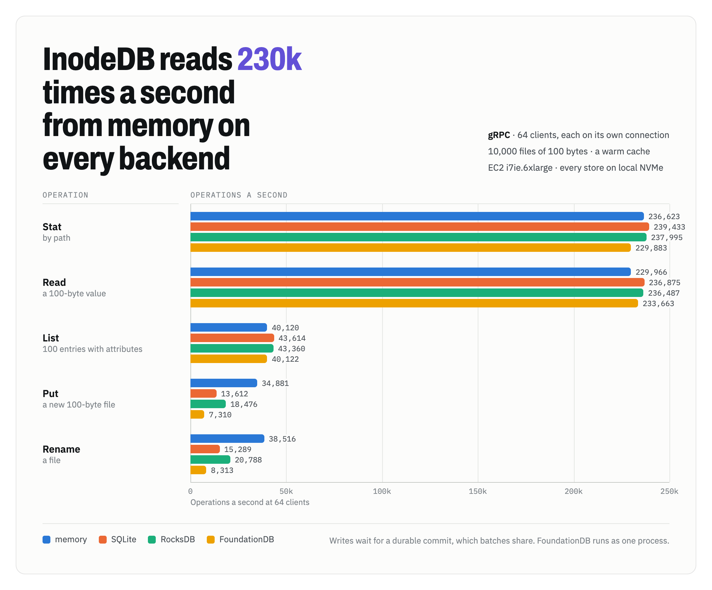
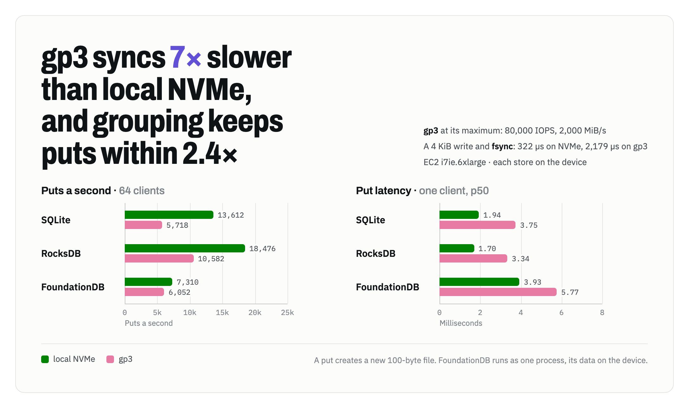

# InodeDB

[](https://github.com/danthegoodman1/inodedb/actions/workflows/ci.yml)

InodeDB is a transactional metadata database whose keyspace is a tree of inodes, so renaming a directory rewrites one entry however much lies beneath it. It is built for systems that keep their data in object storage and commit by renaming directories, such as a ClickHouse object-storage disk, with InodeDB holding the file tree and S3 the blobs. Clients speak gRPC to a Rust server. One server writes at a time, keeping its records in SQLite, RocksDB or FoundationDB behind one storage trait.

Every commit goes through the writer's in-memory cache, so the writer answers reads from memory, at the same rate on every backend: 230,000 a second from 64 clients on an EC2 i7ie.6xlarge. Writes gather into one storage transaction at a time, so with every store on local NVMe, 64 clients create 18,500 files a second on RocksDB and 7,300 on FoundationDB. [BENCHMARKS.md](BENCHMARKS.md) has every result and the commands to reproduce them, and [DESIGN.md](DESIGN.md) is the design.

<picture>
  <source media="(prefers-color-scheme: dark)" srcset="docs/images/ops-dark.png">
  
</picture>

**Status: experimental.** InodeDB passes its storage and API conformance suites on memory, SQLite, RocksDB and FoundationDB, a 100,000-seed simulation sweep, and a run of 116 planted bugs, and has run in tests and benchmarks only. The ClickHouse integration is unbuilt.

## Features

**O(1) directory rename.** Directories map names to inodes, and an inode knows its parent, so a rename moves one entry. Paths resolve through the cache one directory at a time: a six-level path takes 197 ns.

**Atomic batches with conditions.** A batch holds POSIX-style ops: `Mkdir`, `Put`, `Link`, `Unlink`, `Rmdir`, `RemoveAll`, `Rename` with `Replace`, `NoReplace` or `Exchange`, and `SetAttr`. Each op can carry a condition on a path's existence, kind, emptiness or version, or on whether an earlier op applied. A `when` condition fences the whole batch, and `all_or_nothing` applies every op or none. Renames follow `rename(2)`, down to Linux's error order, and a differential test checks them against a real filesystem.

**Exactly-once retries.** Each batch carries a request id, and a retry gets the first answer, across timeouts, lost responses and writer takeovers.

**Coherent caches.** The writer's cache holds every committed batch. Standbys and clients keep their own caches current from the changefeed, and a client's `snapshot()` reads one version until it drops, so most reads cost no round trip.

**A changefeed of any subtree.** `Watch` streams a directory's changes from any retained version. A rename is two entry effects, however much it moves.

**Subtree keys.** Each key acts as a chroot onto one directory, and its root follows that directory through renames. Removing the directory revokes the key and every key minted from it. Handles to inodes carry a MAC, so a handle works only with the key it was issued to.

**Safe freeing.** A freed file's bytes, and whatever they name outside InodeDB, outlive every reader that might still use them. Readers hold leases, and a consumer claims freed files once no lease can reach them, deletes their blobs, and acknowledges them.

**Group commit and fenced failover.** One storage transaction is in flight at a time, and the batches that arrive meanwhile commit together in the next. On FoundationDB, standbys follow the log and take over once the writer's lease lapses, keeping their caches warm. Every commit expects the head record its writer last wrote, so an old writer can never commit after its successor.

**Checked by deterministic simulation.** Each seed runs random batches from several clients through writer crashes, storage faults and stalls, network loss and reordering, drifting clocks, and standby takeovers, and checks every answer against a naive path model. A failing seed replays exactly, and each of 116 planted bugs must be caught by some test.

## Performance

These runs used an EC2 i7ie.6xlarge (24 vCPUs, 192 GiB), with every store on one device at a time: one of its local NVMe drives, or a gp3 volume provisioned at gp3's maximum of 80,000 IOPS and 2,000 MiB/s. FoundationDB ran as one process on its `ssd-2` engine, with its data on the same device. The server ran on 8 threads and the clients on 8 more, each client on its own connection. The tree held 10,000 files of 100 bytes.

Operations a second at 64 clients, on a warm cache, with every store on local NVMe:

| Operation | memory | SQLite | RocksDB | FoundationDB |
|---|--:|--:|--:|--:|
| Stat | 236,623 | 239,433 | 237,995 | 229,883 |
| Read a 100-byte value | 229,966 | 236,875 | 236,487 | 233,663 |
| List 100 entries | 40,120 | 43,614 | 43,360 | 40,122 |
| Put a new 100-byte file | 34,881 | 13,612 | 18,476 | 7,310 |
| Rename a file | 38,516 | 15,289 | 20,788 | 8,313 |

Latency, for reads and writes, at one client's p50 and 64 clients' p99:

<picture>
  <source media="(prefers-color-scheme: dark)" srcset="docs/images/latency-dark.png">
  
</picture>

p50 latency for one client, in ms, with every store on local NVMe:

| Operation | memory | SQLite | RocksDB | FoundationDB |
|---|--:|--:|--:|--:|
| Stat | 0.316 | 0.318 | 0.130 | 0.318 |
| List 100 entries | 0.458 | 0.419 | 0.439 | 0.465 |
| Put a new 100-byte file | 0.408 | 1.941 | 1.701 | 3.933 |
| Rename a file | 0.361 | 1.581 | 1.499 | 3.186 |

Reads cost the same on every backend because the writer answers them from memory. One client's read takes about 0.3 ms, nearly all of it the gRPC round trip, which varied from run to run on this instance: two runs measured 0.11 to 0.13 ms. Writes cost a durable commit, and a put first reads storage once to learn its new name is absent.

A synced 4 KiB write takes 322 µs on local NVMe and 2.2 ms on gp3, even at gp3's maximum provisioning, since each crosses the network. Grouping hides most of the difference:

<picture>
  <source media="(prefers-color-scheme: dark)" srcset="docs/images/devices-dark.png">
  
</picture>

| Put a new 100-byte file | SQLite | RocksDB | FoundationDB |
|---|--:|--:|--:|
| Puts a second at 64 clients, local NVMe | 13,612 | 18,476 | 7,310 |
| Puts a second at 64 clients, gp3 | 5,718 | 10,582 | 6,052 |
| One client's p50, local NVMe | 1.94 ms | 1.70 ms | 3.93 ms |
| One client's p50, gp3 | 3.75 ms | 3.34 ms | 5.77 ms |

At 128 clients, grouping multiplies commit throughput 13 to 30 times on local NVMe and 27 to 49 times on gp3. Failover takes the writer's lease plus a margin: 6.1 s by default, and 0.9 s with a 600 ms lease, measured on a Mac.

### Trade-offs

- **One writer.** Every write goes through one server, so write throughput is one machine's, and each group waits a full commit: on FoundationDB, about 14,000 batches a second at most here.
- **Cold starts.** A restarted writer reads storage for what its cache lacks: on FoundationDB, 16 clients stat 7,200 files a second until the cache warms, against 230,000 after. A standby that takes over brings its cache with it.
- **Memory.** A cached file costs about 830 bytes, so the default budget of 1 Mi inodes takes about 0.8 GB. Raising the `[cache]` budgets keeps more of the tree in memory.
- **Network storage.** On gp3, each sync takes about 7 times as long as on local NVMe, so a single client's write takes 1.5 to 2 times as long.
- **Small values.** A file holds up to 64 KiB. Larger data belongs in object storage, with its location in the file.
- **Planned restarts.** Shutting down leaves the writer's lease to run out, so a planned restart waits the lease plus the margin, as a crash does.
- **Replication.** Standbys need FoundationDB. SQLite and RocksDB keep one copy on one host.

## Compared with ZooKeeper and etcd

| | InodeDB | ZooKeeper or ClickHouse Keeper | etcd |
|---|---|---|---|
| Keyspace | A tree of inodes; directories map names to them | A tree of nodes named by path | Flat keys in byte order |
| Renaming a directory | Rewrites one entry | Rewrites every node beneath it | Rewrites every key under the prefix |
| Transactions | Batches of POSIX-style ops, each with a condition, fenced by `when` | `multi`: every op or none, with version checks | Compare, then put or delete |
| Change feed | A subtree's changes from any retained version | Watches on nodes, from when they are set | Watches on a key or prefix, from any retained revision |
| Caches | The server's, standbys' and clients', kept current by the feed | Left to the client | Left to the client |
| Scoped access | Keys rooted at a directory, revoked with it | Per-node ACLs, and a chroot per connection | Roles over key ranges |
| Freeing external data | Leases hold freed files until no reader can reach them | Left to the client | Leases expire keys |
| Replication | FoundationDB's | ZAB or Raft | Raft |

## Quick start

```console
cat > inodedb.toml <<'EOF'
listen = "127.0.0.1:7070"

[storage]
backend = "sqlite"
path = "data/db.sqlite"
EOF
cargo run --release -p inodedb-server -- --config inodedb.toml --init-key admin.key
```

`--init-key` gives an empty store its first admin key: the one in the file, or a new one written there. `idb` reads its key and endpoint from `INODEDB_KEY` and `INODEDB_ENDPOINT`:

```console
export INODEDB_KEY=$(cat admin.key)
cargo run -p inodedb-cli -- mkdir -p tables/t1/tmp_insert_all_5_5_0
cargo run -p inodedb-cli -- put tables/t1/tmp_insert_all_5_5_0/checksums.txt "..."
cargo run -p inodedb-cli -- mv tables/t1/tmp_insert_all_5_5_0 tables/t1/all_5_5_0
cargo run -p inodedb-cli -- ls -l tables/t1
cargo run -p inodedb-cli -- watch tables/t1
```

From Rust:

```rust
use inodedb::{Client, Cond, Op};

let db = Client::connect("http://127.0.0.1:7070", key).await?;
db.commit([Op::mkdir("tables/t1").parents()]).await?;

// Publish a part in one atomic batch, fenced on the owner file's version.
let mut batch = db
    .batch()
    .when(Cond::version_is("tables/t1/.owner", owner_version))
    .all_or_nothing();
let part = batch.push(Op::mkdir("tables/t1/all_5_5_0"));
batch.push(Op::put("tables/t1/all_5_5_0/checksums.txt", checksums).if_applied(part));
let commit = batch.commit().await?;

// A cache kept current by the changefeed, read through one snapshot.
let replica = db.cached();
replica.wait_for(commit.version).await?;
let snap = replica.snapshot().await?;
for part in snap.list("tables/t1").await?.entries {
    let path = [b"tables/t1/", &part.name[..]].concat();
    let files = snap.list_with_values(&path).await?; // answered from the cache
}
```

The client retries with the same request id, follows `NotWriter` to the writer, and resumes listings cut off midway. `mint_key` and `revoke_key` manage keys, and `watch` streams a subtree's changes.

## Configuration

The server reads one TOML file. Fields, with defaults:

| Field | Default | Effect |
|---|---|---|
| `listen` | | The address to serve gRPC on |
| `advertise` | `http://` and `listen` | The address standbys send clients to for this server |
| `storage.backend` | | `memory`, `sqlite` or `rocksdb` with a `path`, or `fdb` with a `prefix` and an optional `cluster_file` |
| `writer.group_max_bytes` | 9 MB | The most one group commits, under FoundationDB's 10 MB transaction limit |
| `writer.request_ttl_ms` | 10 min | How long a request id answers retries |
| `writer.lease_ms` | 5 s | How long the writer answers reads after a commit; standbys wait this long plus the margin |
| `writer.renew_every_ms` | 1 s | How often an idle writer commits to renew its lease |
| `writer.takeover_margin_ms` | 1 s | What standbys wait beyond the lease, covering clock drift |
| `writer.lease_ttl_ms` | 30 s | How long a reader's lease lasts past its last heartbeat |
| `writer.claim_ttl_ms` | 60 s | How long a consumer's claim on freed files lasts past its last acknowledgment |
| `log.min_retention_ms`, `max_retention_ms` | 5 min, 1 h | How long the changefeed keeps entries, and how long a reader's lease may hold them |
| `cache.dirs`, `inodes`, `value_bytes` | 256 Ki, 1 Mi, 256 MiB | What the writer's cache, and a standby's, holds |

[deploy/kubernetes](deploy/kubernetes/README.md) runs a writer and standbys on FoundationDB as a StatefulSet.

## Documentation

- [DESIGN.md](DESIGN.md): the data model, operations and batches, consistency, the changefeed, caches and snapshots, keys, leases and freeing, the storage contract, the writer and its fencing, the API, the client and CLI, the simulator, and each default with its basis.
- [BENCHMARKS.md](BENCHMARKS.md): every benchmark result, how each ran, and the commands to reproduce it.
- [EVIDENCE.md](EVIDENCE.md): the tests, simulator properties and planted bugs that check each behavior the design names, and the gaps.
- [PLAN.md](PLAN.md): the development plan, with the evidence for each finished item and the work that remains.

## Development

Building `crates/proto` needs `protoc` (`brew install protobuf` or `apt-get install protobuf-compiler`).

```console
cargo test --workspace                                   # unit, scenario and API tests on memory and SQLite
cargo test --workspace --features rocksdb                # and on RocksDB
scripts/fdb                                              # storage and API conformance on FoundationDB, in Docker
cargo run --release -p inodedb-sim -- --seeds 10000      # 10,000 simulation seeds from a random start
cargo run --release -p inodedb-sim -- 541                # replay one seed
scripts/posix                                            # the POSIX differential test on Linux, in Docker
scripts/mutants                                          # every planted bug against every test layer
scripts/ec2/setup && scripts/ec2/bench                  # the benchmarks on an EC2 instance with local NVMe and gp3
node docs/images/render.mjs                              # the README's charts, from docs/images/charts.html
```

The README's charts come from the data in `docs/images/charts.html`; after editing it, `docs/images/render.mjs` renders each in both themes with headless Chrome.

| Path | Contents |
|---|---|
| `crates/core` | Inode semantics, batch execution, the cache and snapshots, changefeed effects, leases, `fsck`; no I/O, clocks or threads |
| `crates/storage` | The storage trait, key encoding and the memory backend |
| `crates/storage-sqlite`, `storage-rocksdb`, `storage-fdb` | The backends |
| `crates/storage-conformance` | The storage contract as a test suite for any backend |
| `crates/server` | The gRPC service, auth, the writer with group commit and fencing, standbys |
| `crates/client` | The Rust client, with its cache, leases and snapshots |
| `crates/cli` | `idb`, with `fsck`, `watch` and a read-only FUSE `mount` |
| `crates/sim` | The deterministic simulator and its scenarios |
| `tests` | API conformance against a running server, and the benchmarks |

CI runs rustfmt, clippy with warnings as errors, and every test on memory, SQLite and RocksDB, the POSIX differential test among them; storage and API conformance and the FUSE mount test on FoundationDB; and 2,000 simulation seeds from the commit hash.
