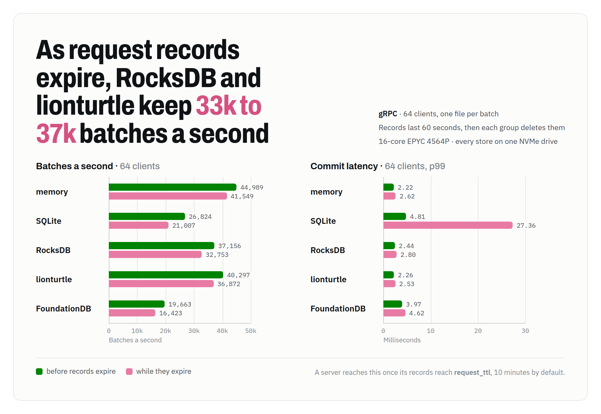

# InodeDB

[](https://github.com/danthegoodman1/inodedb/actions/workflows/ci.yml)

InodeDB is a transactional metadata database whose keyspace is a tree of inodes, so renaming a directory rewrites one entry however much lies beneath it. It is built for systems that keep their data in object storage and commit by renaming directories, such as a ClickHouse object-storage disk, with InodeDB holding the file tree and S3 the blobs. Clients speak gRPC to a Rust server. One server writes at a time, keeping its records in SQLite, RocksDB, [lionturtle](https://github.com/danthegoodman1/lionturtle) or FoundationDB behind one storage trait.

Every commit goes through the writer's in-memory cache, so the writer answers reads from memory, at the same rate on every backend: 390,000 a second from 64 clients on a 16-core EPYC 4564P, and in 23 µs for one client. Writes gather into one storage transaction at a time, so with every store on one NVMe drive, 64 clients create 93,000 files a second on lionturtle, 84,000 on RocksDB, 37,000 on SQLite and 23,000 on FoundationDB. [BENCHMARKS.md](BENCHMARKS.md) has every result and the commands to reproduce them, and [DESIGN.md](DESIGN.md) is the design.

<picture>
  <source media="(prefers-color-scheme: dark)" srcset="docs/images/ops-dark.png">
  
</picture>

**Status: experimental.** InodeDB passes its storage and API conformance suites on memory, SQLite, RocksDB, lionturtle and FoundationDB, a 100,000-seed simulation sweep, and a run of 279 planted bugs, and has run in tests and benchmarks only. The ClickHouse integration is unbuilt.

## Features

**O(1) directory rename.** Directories map names to inodes, and an inode knows its parent, so a rename moves one entry. Paths resolve through the cache one directory at a time: a six-level path takes under 200 ns.

**Atomic batches with conditions.** A batch holds POSIX-style ops: `Mkdir`, `Put`, `Link`, `Unlink`, `Rmdir`, `RemoveAll`, `Rename` with `Replace`, `NoReplace` or `Exchange`, and `SetAttr`. Each op can carry a condition on a path's existence, kind, emptiness or version, or on whether an earlier op applied. A `when` condition fences the whole batch, and `all_or_nothing` applies every op or none. Renames follow `rename(2)`, down to Linux's error order, and a differential test checks them against a real filesystem.

**Exactly-once retries.** Each batch carries a request id, and a retry gets the first answer, across timeouts, lost responses and writer takeovers.

**Coherent caches.** The writer's cache holds every committed batch. Standbys and clients keep their own caches current from the changefeed, and a client's `snapshot()` reads one version until it drops, so most reads cost no round trip.

**A changefeed of any subtree.** `Watch` streams a directory's changes from any retained version. A rename is two entry effects, however much it moves.

**Subtree keys.** Each key acts as a chroot onto one directory, and its root follows that directory through renames. Removing the directory revokes the key and every key minted from it. Handles to inodes carry a MAC, so a handle works only with the key it was issued to.

**Safe freeing.** A freed file's bytes, and whatever they name outside InodeDB, outlive every reader that might still use them. Readers hold leases, and a consumer claims freed files once no lease can reach them, deletes their blobs, and acknowledges them.

**Group commit and fenced failover.** One storage transaction is in flight at a time, and the batches that arrive meanwhile commit together in the next. On FoundationDB, standbys follow the log and take over once the writer's lease lapses, or at once when it stops cleanly, keeping their caches warm. Every commit expects the head record its writer last wrote, so an old writer can never commit after its successor.

**Reads with no hop.** A read the cache holds answers on the request's own task, under a shared lock on the writer, so reads scale with the server's threads. `crates/transport` drives HTTP/2 directly: a reply's headers and data leave in one write, and a request whose answer is ready needs no task of its own.

**Commits that overwrite.** SQLite, RocksDB and lionturtle write their log files when a store opens, so a durable write costs one 4 KiB write and no file-system journal commit: 24 µs on an enterprise NVMe drive. On lionturtle, one client's put takes 93 µs.

**A warm start.** A starting writer or standby reads the tree into its cache while it serves, directories first and up to its budget, so 16 clients stat 224,000 to 255,000 files a second as a server starts.

**Checked by deterministic simulation.** Each seed runs random batches from several clients through writer crashes, storage faults and stalls, network loss and reordering, drifting clocks, and standby takeovers, and checks every answer against a naive path model. A failing seed replays exactly, and each of 279 planted bugs must be caught by some test.

## Performance

These runs used a Latitude.sh `f4.metal.medium` (16-core EPYC 4564P, 187 GiB), with every store on one Micron NVMe drive that reports no volatile write cache. FoundationDB ran one process per role on its `ssd-2` engine, with its data on the same drive. The server ran on 8 threads and the clients on 8 more, each client on its own connection. The tree held 10,000 files of 100 bytes. Each backend ran in its own process, and each cell is the median of three passes.

Operations a second at 64 clients, on a warm cache:

| Operation | memory | SQLite | RocksDB | lionturtle | FoundationDB |
|---|--:|--:|--:|--:|--:|
| Stat | 383,880 | 392,433 | 400,626 | 390,760 | 400,025 |
| Read a 100-byte value | 390,314 | 387,962 | 390,105 | 388,694 | 389,710 |
| List 100 entries | 168,008 | 173,103 | 168,283 | 165,466 | 169,647 |
| Put a new 100-byte file | 95,960 | 36,680 | 84,118 | 92,673 | 22,851 |
| Rename a file | 103,663 | 41,603 | 90,673 | 101,991 | 21,894 |
| Nine stats for each put | 303,729 | 249,206 | 290,512 | 288,500 | 175,669 |

Latency, for reads and writes, at one client's p50 and 64 clients' p99:

<picture>
  <source media="(prefers-color-scheme: dark)" srcset="docs/images/latency-dark.png">
  
</picture>

p50 latency for one client, in ms:

| Operation | memory | SQLite | RocksDB | lionturtle | FoundationDB |
|---|--:|--:|--:|--:|--:|
| Stat | 0.023 | 0.023 | 0.023 | 0.023 | 0.022 |
| List 100 entries | 0.058 | 0.058 | 0.058 | 0.058 | 0.058 |
| Put a new 100-byte file | 0.051 | 0.164 | 0.108 | 0.093 | 1.005 |
| Rename a file | 0.048 | 0.150 | 0.103 | 0.094 | 1.004 |

Reads cost the same on every backend because the writer answers them from memory, and nearly all of one client's 23 µs is the gRPC round trip. Writes cost a durable commit, and a put first reads storage once to learn its new name is absent. lionturtle is the fastest durable backend for writes: over six alternating passes, it won every pass against RocksDB on puts and renames, by 10% and 15% at 64 clients and by 11% and 13% at one client. Its puts come within 4% of the memory backend's, and its renames within 2%. Warm reads and the mixed workload ran level, and RocksDB kept the lower write p99 at 64 clients: 0.94 ms against 1.02 ms on renames. FoundationDB's 1.0 ms is the window in which its commit proxy gathers transactions; with that window at 0.1 ms, a put took 0.58 ms.

Every batch leaves a request record, and once records reach their lifetime, each group deletes as many as it writes. A server under steady load stays in that state. Each group names every key it deletes, which keeps the cost to 8% to 22% of the rate:

<picture>
  <source media="(prefers-color-scheme: dark)" srcset="docs/images/expiry-dark.png">
  
</picture>

| 64 clients, batches a second | memory | SQLite | RocksDB | lionturtle | FoundationDB |
|---|--:|--:|--:|--:|--:|
| Before records expire | 44,989 | 26,824 | 37,156 | 40,297 | 19,663 |
| While records expire | 41,549 | 21,007 | 32,753 | 36,872 | 16,423 |

Grouping hides most of a sync's cost: at 128 clients it multiplies FoundationDB's commit throughput by 30, even on a drive this fast. On gp3 at its maximum provisioning, where a sync costs 28 times this drive's, it multiplied SQLite's, RocksDB's and FoundationDB's by 17 to 18 ([Network storage](BENCHMARKS.md#network-storage)). Failover takes the writer's lease plus a margin: 6.3 s by default on FoundationDB, and 0.9 s with a 600 ms lease. A clean stop hands the store to a standby at once.

### Trade-offs

- **One writer.** Every write goes through one server, so write throughput is one machine's: 93,000 to 96,000 puts a second at 64 clients on lionturtle and the memory backend, and each group waits a full commit, so about 29,000 batches a second at most on FoundationDB.
- **Cold starts.** A restarted server reads storage for what its cache lacks until its preload finishes. A tree larger than `cache.tree_bytes` stays partly cold: on FoundationDB, 16 clients stat 41,000 files a second on a cold cache, and 64 clients stat 390,000 on a warm one. A standby that takes over brings its cache with it.
- **Memory.** The cache charges each record at least what it holds, a cached file about 980 bytes, so the default `tree_bytes` of 1 GiB holds about a million files in at most 1 GiB. Raising the `[cache]` budgets keeps more of the tree in memory.
- **Expiring records.** Once records begin to expire, which is 10 minutes in by default, each group also deletes as many as it writes. That costs lionturtle 8%, RocksDB 12%, and SQLite 22% with its p99 at 27 ms ([Expiring records](BENCHMARKS.md#expiring-records)).
- **Network storage.** On EC2's gp3, one client's put took 2.2 to 8.4 times as long as on local NVMe, and 64 clients' puts ran at about a third to a half the rate. lionturtle hasn't run there.
- **Disk at open.** Opening a store writes its log files: 128 MiB on SQLite, 235 MiB on RocksDB, and 144 MiB on lionturtle, which writes two more segments of that size behind it. They stay at about that size whatever the store holds.
- **A failed write on lionturtle.** It stops the store, which answers `Unavailable` until the server restarts and recovers from its log.
- **Idle power.** A running server keeps every core out of idle states deeper than C1, which costs power. On EC2, a put on RocksDB took 9 times as long without that ([Idle states](BENCHMARKS.md#idle-states)). `shallow_idle = false` leaves the states alone.
- **Memory.** A server keeps the memory it frees for its next allocations, so it holds the most it has used. Returning it stalled commits on lionturtle for 4 to 40 ms ([Sustained puts](BENCHMARKS.md#sustained-puts)). `keep_memory = false` returns it.
- **Small values.** A file holds up to 64 KiB. Larger data belongs in object storage, with its location in the file.
- **Replication.** Standbys need FoundationDB. SQLite, RocksDB and lionturtle keep one copy on one host.

## Compared with ZooKeeper and etcd

| | InodeDB | ZooKeeper or ClickHouse Keeper | etcd |
|---|---|---|---|
| Keyspace | A tree of inodes; directories map names to them | A tree of nodes named by path | Flat keys in byte order |
| Renaming a directory | Rewrites one entry | Rewrites every node beneath it | Rewrites every key under the prefix |
| Transactions | Batches of POSIX-style ops, each with a condition, fenced by `when` | `multi`: every op or none, with version checks | Compare, then put or delete |
| Change feed | A subtree's changes from any retained version | Watches on nodes, from when they are set | Watches on a key or prefix, from any retained revision |
| Caches | The server's, standbys' and clients', kept current by the feed | Left to the client | Left to the client |
| Scoped access | Keys rooted at a directory, revoked with it | Per-node ACLs, and a chroot per connection | Roles over key ranges |
| Freeing external data | Leases hold freed files until no reader can reach them | Left to the client | Leases expire keys |
| Replication | FoundationDB's | ZAB or Raft | Raft |

## Quick start

```console
cat > inodedb.toml <<'EOF'
listen = "127.0.0.1:7070"

[storage]
backend = "sqlite"
path = "data/db.sqlite"
EOF
cargo run --release -p inodedb-server -- --config inodedb.toml --init-key admin.key
```

`--init-key` gives an empty store its first admin key: the one in the file, or a new one written there. `idb` reads its key and endpoint from `INODEDB_KEY` and `INODEDB_ENDPOINT`:

```console
export INODEDB_KEY=$(cat admin.key)
cargo run -p inodedb-cli -- mkdir -p tables/t1/tmp_insert_all_5_5_0
cargo run -p inodedb-cli -- put tables/t1/tmp_insert_all_5_5_0/checksums.txt "..."
cargo run -p inodedb-cli -- mv tables/t1/tmp_insert_all_5_5_0 tables/t1/all_5_5_0
cargo run -p inodedb-cli -- ls -l tables/t1
cargo run -p inodedb-cli -- watch tables/t1
```

From Rust, with the client from crates.io (`cargo add inodedb-client`, imported as `inodedb`):

```rust
use inodedb::{Client, Cond, Op};

let db = Client::connect("http://127.0.0.1:7070", key).await?;
db.commit([Op::mkdir("tables/t1").parents()]).await?;

// Publish a part in one atomic batch, fenced on the owner file's version.
let mut batch = db
    .batch()
    .when(Cond::version_is("tables/t1/.owner", owner_version))
    .all_or_nothing();
let part = batch.push(Op::mkdir("tables/t1/all_5_5_0"));
batch.push(Op::put("tables/t1/all_5_5_0/checksums.txt", checksums).if_applied(part));
let commit = batch.commit().await?;

// A cache kept current by the changefeed, read through one snapshot.
let replica = db.cached();
replica.wait_for(commit.version).await?;
let snap = replica.snapshot().await?;
for part in snap.list("tables/t1").await?.entries {
    let path = [b"tables/t1/", &part.name[..]].concat();
    let files = snap.list_with_values(&path).await?; // answered from the cache
}
```

The client retries with the same request id, follows `NotWriter` to the writer, and resumes listings cut off midway. `mint_key` and `revoke_key` manage keys, and `watch` streams a subtree's changes.

## Configuration

The server reads one TOML file. Fields, with defaults:

| Field | Default | Effect |
|---|---|---|
| `listen` | | The address to serve gRPC on |
| `advertise` | `http://` and `listen` | The address standbys send clients to for this server |
| `shallow_idle` | on | Keep every core out of idle states deeper than C1 while the server runs; it needs root or a device rule for `/dev/cpu_dma_latency` |
| `keep_memory` | on | Keep freed memory for the server's next allocations, where the allocator would return it to the kernel |
| `storage.backend` | | `memory`; `sqlite`, `rocksdb` or `lionturtle` with a `path`; or `fdb` with a `prefix` and an optional `cluster_file` |
| `writer.group_max_bytes` | 9 MB | The most one group commits, under FoundationDB's 10 MB transaction limit |
| `writer.request_ttl_ms` | 10 min | How long a request id answers retries |
| `writer.lease_ms` | 5 s | How long the writer answers reads after a commit; standbys wait this long plus the margin |
| `writer.renew_every_ms` | 1 s | How often an idle writer commits to renew its lease |
| `writer.takeover_margin_ms` | 1 s | What standbys wait beyond the lease, covering clock drift |
| `writer.lease_ttl_ms` | 30 s | How long a reader's lease lasts past its last heartbeat |
| `writer.claim_ttl_ms` | 60 s | How long a consumer's claim on freed files lasts past its last acknowledgment |
| `log.min_retention_ms`, `max_retention_ms` | 5 min, 1 h | How long the changefeed keeps entries, and how long a reader's lease may hold them |
| `cache.tree_bytes`, `value_bytes` | 1 GiB, 256 MiB | What the writer's cache, and a standby's, holds |
| `cache.preload` | on | Read the tree into the cache as the server starts, up to those budgets |

[deploy/kubernetes](deploy/kubernetes/README.md) runs a writer and standbys on FoundationDB as a StatefulSet.

## Documentation

- [DESIGN.md](DESIGN.md): the data model, operations and batches, consistency, the changefeed, caches and snapshots, keys, leases and freeing, the storage contract, the writer and its fencing, the API, the client and CLI, the simulator, and each default with its basis.
- [BENCHMARKS.md](BENCHMARKS.md): every benchmark result, how each ran, and the commands to reproduce it.
- [EVIDENCE.md](EVIDENCE.md): the tests, simulator properties and planted bugs that check each behavior the design names, and the gaps.
- [PLAN.md](PLAN.md): the development plan, with the evidence for each finished item and the work that remains.
- [RELEASING.md](RELEASING.md): how each merge to `main` publishes the client's crates to crates.io.

## Development

The tests need `protoc` (`brew install protobuf` or `apt-get install protobuf-compiler`): `crates/proto` holds the code generated from `proto/inodedb.proto`, and its test checks that code and rewrites it when the proto file changes.

Run cargo inside the repository. Its `.cargo/config.toml` builds SQLite to sync with `fdatasync`, and cargo reads that file only from there, so a build started elsewhere stops and says so. To build from another directory, pass the file along:

```console
cargo build --release --config inodedb/.cargo/config.toml --manifest-path inodedb/Cargo.toml -p inodedb-server
```

```console
cargo test --workspace                                   # unit, scenario and API tests on memory, SQLite and lionturtle
cargo test --workspace --features rocksdb                # and on RocksDB
scripts/fdb                                              # storage and API conformance on FoundationDB, in Docker
cargo run --release -p inodedb-sim -- --seeds 10000      # 10,000 simulation seeds from a random start
cargo run --release -p inodedb-sim -- 541                # replay one seed
scripts/posix                                            # the POSIX differential test on Linux, in Docker
scripts/mutants                                          # every planted bug against every test layer
scripts/mutants --rocksdb                                # the planted bugs in the RocksDB backend
scripts/mutants --lionturtle                             # the planted bugs in the lionturtle backend
scripts/fdb python3 scripts/mutants --fdb                # the planted bugs in the FoundationDB backend
scripts/bench/setup && scripts/bench/run                 # the benchmarks on a machine with local NVMe, and gp3 on EC2
node docs/images/render.mjs                              # the README's charts, from docs/images/charts.html
```

The README's charts come from the data in `docs/images/charts.html`; after editing it, `docs/images/render.mjs` renders each in both themes with headless Chrome.

| Path | Contents |
|---|---|
| `crates/core` | Inode semantics, batch execution, the cache and snapshots, changefeed effects, leases, `fsck`; no I/O, clocks or threads |
| `crates/storage` | The storage trait, key encoding and the memory backend |
| `crates/storage-sqlite`, `storage-rocksdb`, `storage-lionturtle`, `storage-fdb` | The backends |
| `crates/storage-conformance` | The storage contract as a test suite for any backend |
| `crates/server` | The gRPC service, auth, the writer with group commit and fencing, standbys |
| `crates/transport` | gRPC over `h2`, for the server and the client: one write per reply, and no task for a request whose answer is ready |
| `crates/client` | The Rust client, with its cache, leases and snapshots |
| `crates/cli` | `idb`, with `fsck`, `watch` and a read-only FUSE `mount` |
| `crates/sim` | The deterministic simulator and its scenarios |
| `tests` | API conformance against a running server, and the benchmarks |

CI runs rustfmt, clippy with warnings as errors, and every test on memory, SQLite, RocksDB and lionturtle, the POSIX differential test among them; storage and API conformance and the FUSE mount test on FoundationDB; and 2,000 simulation seeds from the commit hash.
